# 🐾 PetFace

Plataforma web de **adopción de mascotas**: las personas conocen a los perros y gatos disponibles, solicitan adoptarlos y hacen donaciones; el equipo administra el catálogo y aprueba las adopciones.

Proyecto universitario construido con **React + Node.js/Express (MVC) + PostgreSQL**.

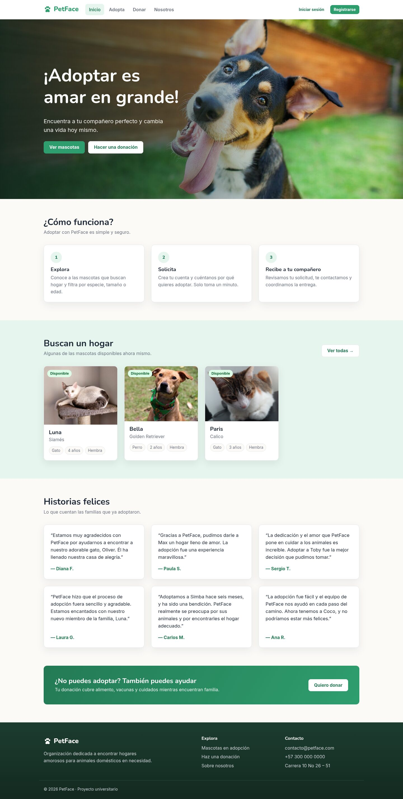

## Funcionalidades

**Para visitantes y adoptantes**
- Catálogo de mascotas con búsqueda y filtros (especie, género, tamaño, estado).
- Ficha de cada mascota y **solicitud de adopción** en línea.
- Registro e inicio de sesión con contraseña cifrada y sesión persistente.
- "Mi perfil": seguimiento de solicitudes (pendiente / aprobada / rechazada) y envío de testimonios.
- Donaciones (simuladas, sin cobro real).

**Para administradores**
- Resumen con contadores.
- **CRUD de mascotas** con subida de fotos.
- Aprobación o rechazo de solicitudes: al aprobar, la mascota queda adoptada y las demás solicitudes se rechazan solas.
- Moderación de testimonios y listado de donaciones.

| Catálogo | Ficha y adopción |
|---|---|
| 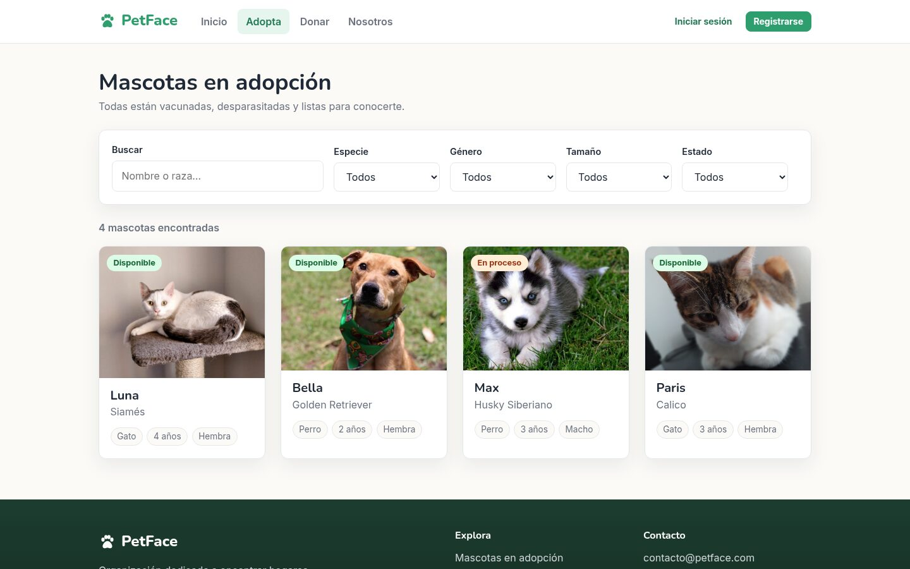 | 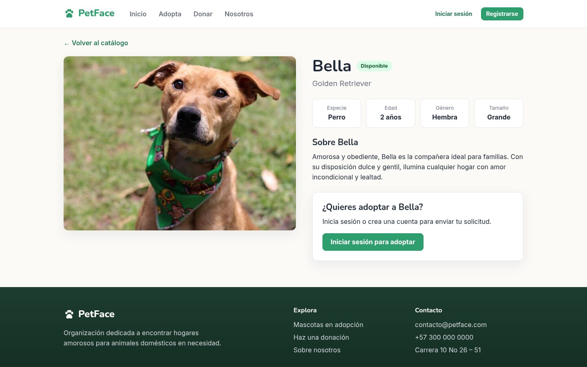 |
| **Panel de admin** | **Solicitudes** |
| 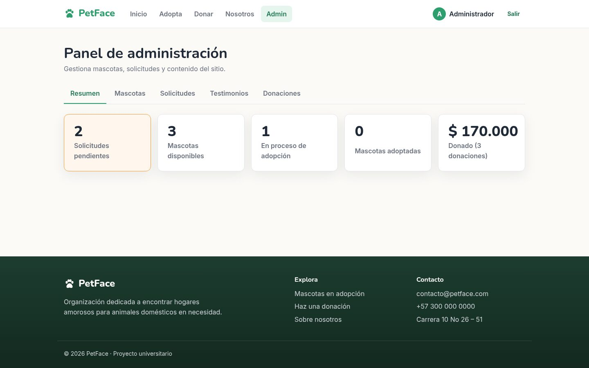 | 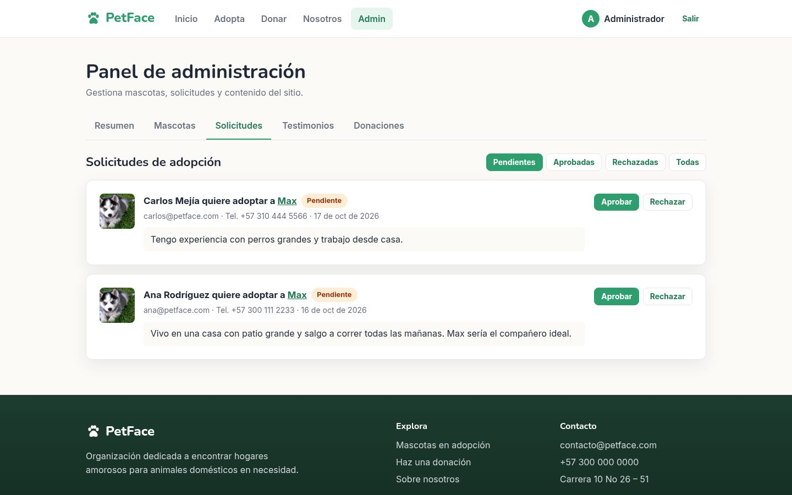 |
| **CRUD de mascotas** | **Formulario con subida de foto** |
| 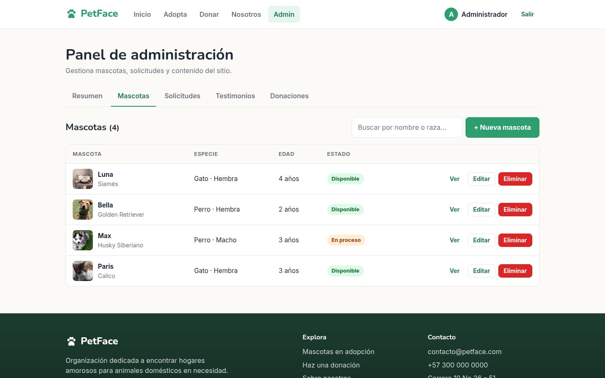 | 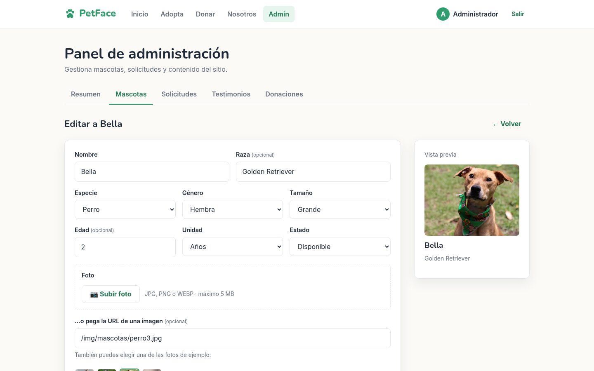 |

<p align="center">
  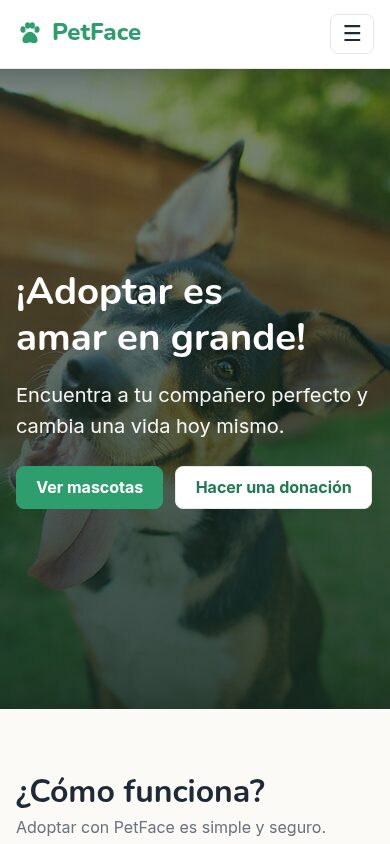
  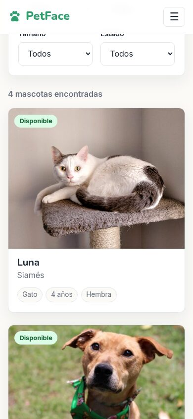
  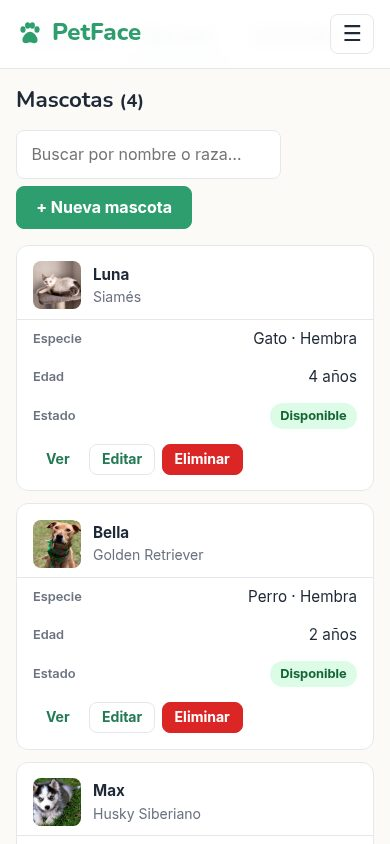
</p>

## Tecnologías

| Capa | Tecnología |
|---|---|
| Frontend (Vista) | React 18, React Router 6, Vite 5, CSS propio con variables de diseño |
| Backend (Modelo + Controlador) | Node.js 22+, Express 5 |
| Base de datos | PostgreSQL 16 (en Docker), consultas SQL con `pg` |
| Autenticación | bcryptjs + JWT en cookie `httpOnly`, roles `admin` / `adoptante` |
| Subida de archivos | multer |
| Pruebas | `node:test` (sin librerías extra) |

## Arquitectura (MVC)

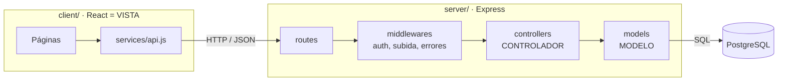

Ejemplo del recorrido de una petición: `PUT /api/mascotas/3` → `routes/mascotas.routes.js` (exige admin) → `controllers/mascotas.controller.js` (valida los datos) → `models/mascota.model.js` (ejecuta el `UPDATE`) → respuesta JSON.

## Puesta en marcha

**Requisitos:** Node.js 22 o superior y Docker con Docker Compose.

```bash
npm install                         # instala client y server (npm workspaces)
cp server/.env.example server/.env  # variables de entorno del backend
npm run db:up                       # levanta PostgreSQL con tablas y datos de prueba
npm run dev                         # API en :3000 y web en :5173
```

Abre **http://localhost:5173**.

### Usuarios de prueba

| Rol | Email | Contraseña |
|---|---|---|
| Admin | admin@petface.com | admin123 |
| Adoptante | ana@petface.com | ana12345 |
| Adoptante | carlos@petface.com | carlos123 |

También puedes crear tu propia cuenta en `/registro`.

## Despliegue en Vercel

El repositorio está listo para Vercel (`vercel.json`): la web se publica como sitio estático y la API de Express corre como función serverless (`api/index.js`), todo bajo la misma URL.

| Variable de entorno (Vercel → Settings → Environment Variables) | Para qué |
|---|---|
| `DATABASE_URL` | Conexión a PostgreSQL en **Neon** (usa la cadena *pooled*) |
| `JWT_SECRET` | Texto largo y aleatorio para firmar las sesiones (`openssl rand -hex 32`) |
| `BLOB_READ_WRITE_TOKEN` | Lo crea Vercel al conectar un **Blob store** público; guarda las fotos subidas |

- En cada despliegue, `server/scripts/migrar.js` crea las tablas y los datos de demo **solo si la base de datos está vacía**; nunca borra datos.
- Node.js 24 (fijado en `package.json` → `engines`).
- Límite de Vercel: 4,5 MB por petición, por eso las fotos admiten hasta 4 MB.

## Scripts

| Comando | Qué hace |
|---|---|
| `npm run dev` | Levanta backend y frontend a la vez |
| `npm run dev:client` / `dev:server` | Solo uno de los dos |
| `npm test` | Pruebas de la API (requiere la BD encendida) |
| `npm run lint` | Revisa el código del frontend |
| `npm run build` | Compila el frontend |
| `npm run db:up` / `db:down` | Enciende / apaga PostgreSQL |
| `npm run db:reset` | **Borra** la BD y la recrea desde `database/*.sql` |
| `npm run db:psql` | Consola SQL dentro del contenedor |
| `npm run db:migrar` | Crea tablas + datos de demo si la BD (de `DATABASE_URL`) está vacía |

## Estructura

```
client/src/
  pages/             páginas (Inicio, Adopta, DetalleMascota, Perfil, admin/…)
  components/        piezas reutilizables (Navbar, PetCard, Modal, Campo…)
  context/           sesión (AuthProvider) y avisos (ToastProvider)
  hooks/             useApi, useTitulo
  services/api.js    comunicación con el backend
  styles/            tokens de diseño y estilos base
server/src/
  config/            conexión a PostgreSQL y carpeta de fotos
  models/            MODELO: consultas SQL
  controllers/       CONTROLADOR: validación y lógica de cada petición
  routes/            URL → controlador
  middlewares/       autenticación, subida de fotos, errores
server/test/         pruebas de la API
server/uploads/      fotos subidas en local (en Vercel van a Vercel Blob)
server/scripts/      migrar.js: prepara la BD en cada despliegue
api/index.js         entrada de la API en Vercel
database/            schema.sql (tablas) y seed.sql (datos de prueba)
vault/               documentación del proyecto (Obsidian)
```

## API

Todos los endpoints están documentados en [`vault/02 Arquitectura/API REST.md`](vault/02%20Arquitectura/API%20REST.md). Resumen:

| Recurso | Endpoints |
|---|---|
| Auth | `POST /api/auth/registro`, `/login`, `/logout` · `GET /api/auth/me` |
| Mascotas | `GET /api/mascotas?especie=&genero=&tamano=&estado=&q=` · `GET/PUT/DELETE /api/mascotas/:id` · `POST /api/mascotas` |
| Solicitudes | `POST /api/solicitudes` · `GET /api/solicitudes/mias` · `DELETE /api/solicitudes/:id` · `GET /api/solicitudes` · `PATCH /api/solicitudes/:id` |
| Donaciones | `POST /api/donaciones` · `GET /api/donaciones` |
| Testimonios | `GET /api/testimonios` · `GET /api/testimonios/todos` · `POST` · `PATCH/DELETE /api/testimonios/:id` |
| Otros | `GET /api/admin/resumen` · `POST /api/uploads` · `GET /api/health` |

## Seguridad

- Contraseñas cifradas con bcrypt; nunca se devuelven en las respuestas.
- Sesión en cookie `httpOnly` (JavaScript del navegador no puede leerla).
- Rutas protegidas por rol en el backend (no solo ocultas en el frontend).
- Login bloqueado 15 minutos tras 5 intentos fallidos.
- Consultas SQL siempre parametrizadas (`$1, $2…`) contra inyección SQL.
- Subida de fotos: solo admin, JPG/PNG/WEBP hasta 4 MB, se verifica el contenido real del archivo y se guarda con nombre aleatorio.

## Solución de problemas

| Problema | Solución |
|---|---|
| `/api/health` dice `"db":"error"` | Docker apagado: `sudo systemctl start docker` y luego `npm run db:up` |
| Cambié `database/*.sql` y no se refleja | Los scripts solo corren la primera vez: `npm run db:reset` (borra los datos) |
| Puerto 3000 o 5173 ocupado | Cierra el otro proceso o cambia `PORT` en `server/.env` |
| No puedo iniciar sesión | Tras 5 intentos fallidos hay que esperar 15 min (o reiniciar el servidor) |

## Documentación

El vault de Obsidian en [`vault/`](vault/) contiene el análisis inicial, las decisiones de arquitectura (ADRs), el roadmap, la guía de diseño, la bitácora de cada fase y una **guía para la sustentación**. Empieza por `vault/00 - Inicio.md`.
