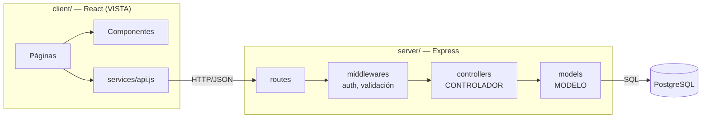

# Arquitectura propuesta

Objetivo: **MVC claro y fácil de explicar en clase**, sin sobre-ingeniería.

## Vista general


## Cómo encaja MVC
| Capa | Dónde | Responsabilidad |
|---|---|---|
| **Modelo** | `server/src/models/` | Acceso a datos: consultas SQL a PostgreSQL. Ej: `Mascota.findAll()`, `Mascota.create()` |
| **Controlador** | `server/src/controllers/` | Recibe la petición, valida, llama al modelo y responde JSON |
| **Vista** | `client/` (React) | Muestra datos y captura acciones del usuario |
| Rutas | `server/src/routes/` | Mapea URL + método → controlador |
| Middlewares | `server/src/middlewares/` | Autenticación, roles, manejo de errores |

## Estructura de carpetas
```
petface/
├── client/                 ← el React actual, reorganizado
│   └── src/
│       ├── pages/          (Inicio, Adopta, DetalleMascota, Login, Registro, Admin…)
│       ├── components/     (Navbar, Footer, PetCard, Modal, Button…)
│       ├── context/        (AuthContext)
│       ├── services/       (api.js — fetch al backend)
│       └── styles/         (tokens.css + globales)
├── server/
│   └── src/
│       ├── config/db.js    (pool de pg)
│       ├── models/
│       ├── controllers/
│       ├── routes/
│       ├── middlewares/
│       └── app.js
├── database/
│   ├── schema.sql
│   └── seed.sql
├── docker-compose.yml      (PostgreSQL)
└── vault/                  ← este cerebro
```

Relacionado: [[ADR-001 Stack backend]], [[ADR-004 Estructura del repositorio]], [[Modelo de datos]], [[API REST]].

## Implementado en Fase 1
- npm **workspaces**: `npm install` en la raíz instala `client` y `server`; `npm run dev` levanta ambos con `concurrently`.
- **Express 5**. Las variables de entorno se cargan con la opción nativa de Node `--env-file-if-exists=.env` (sin `dotenv`).
- Vite redirige `/api` → `http://localhost:3000` (proxy), así no hace falta CORS.
- Ejemplo completo de MVC: `GET /api/health` → `routes/health.routes.js` → `controllers/health.controller.js` → `models/health.model.js` → PostgreSQL.
- Las fotos de mascotas se movieron a `client/public/img/mascotas/` para que la columna `foto_url` de la BD apunte a ellas (`/img/mascotas/paris.jpg`).

## Implementado en Fase 2
- **4 recursos** con su modelo, controlador y rutas: mascotas, solicitudes, donaciones, testimonios (+ `admin/resumen`).
- `utils/validar.js`: validadores pequeños hechos a mano (texto, opción, entero, número, email, id). Lanzan `HttpError(400)`.
- `utils/httpError.js` + `middlewares/errorHandler.js`: un solo lugar para convertir errores en respuestas JSON (incluye códigos de PostgreSQL → 409/400).
- Express 5 captura los errores de funciones `async`, por eso los controladores no necesitan `try/catch`.
- Las reglas de negocio de adopción viven en `models/solicitud.model.js` y usan **transacciones** (`BEGIN/COMMIT/ROLLBACK`) con `SELECT ... FOR UPDATE`.
- Pruebas en `server/test/api.test.js` con `node:test` (sin librerías extra) → `npm test`.
