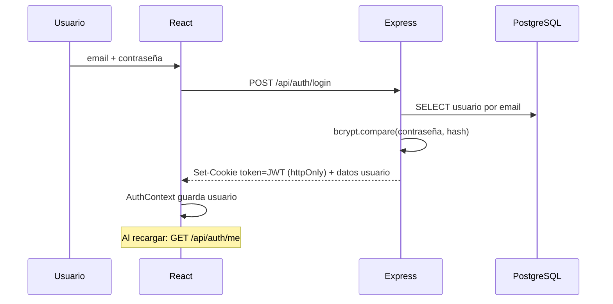

# Autenticación (login mejorado)

## Hoy
Solo un nombre en `useState`. Ver [[Problemas detectados#Login]].

## Propuesta

- **Registro** con nombre, email, contraseña (mín. 8 caracteres) y teléfono opcional.
- Contraseñas con **bcrypt** (nunca en texto plano).
- **JWT** en cookie `httpOnly` (no accesible desde JS → más seguro que localStorage), expira en 7 días.
- **Roles**: `adoptante` y `admin`. Middlewares `requireAuth` y `requireAdmin`.
- En React: `AuthContext` + rutas protegidas (`<RutaPrivada>`, `<RutaAdmin>`).
- UX: mostrar/ocultar contraseña, errores por campo, botón con estado de carga, redirigir a la página que se quería ver.

Relacionado: [[ADR-003 Autenticación con JWT en cookie]].
