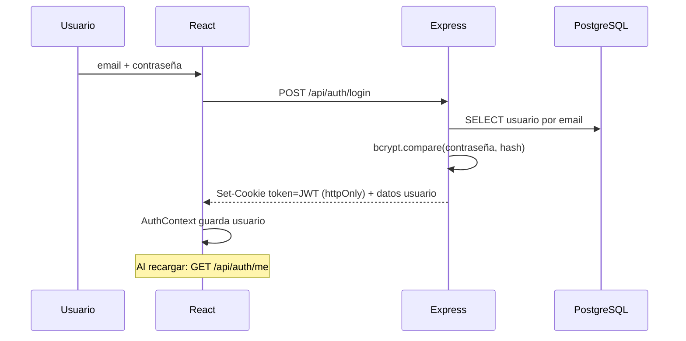

# Autenticación (login mejorado)

## Hoy
Solo un nombre en `useState`. Ver [[Problemas detectados#Login]].

## Propuesta

- **Registro** con nombre, email, contraseña (mín. 8 caracteres) y teléfono opcional.
- Contraseñas con **bcrypt** (nunca en texto plano).
- **JWT** en cookie `httpOnly` (no accesible desde JS → más seguro que localStorage), expira en 7 días.
- **Roles**: `adoptante` y `admin`. Middlewares `requireAuth` y `requireAdmin`.
- En React: `AuthContext` + rutas protegidas (`<RutaPrivada>`, `<RutaAdmin>`).
- UX: mostrar/ocultar contraseña, errores por campo, botón con estado de carga, redirigir a la página que se quería ver.

Relacionado: [[ADR-003 Autenticación con JWT en cookie]].

## Implementado (Fase 3)
**Backend**
- `models/usuario.model.js` · `controllers/auth.controller.js` · `routes/auth.routes.js`
- Contraseñas con **bcryptjs** (JavaScript puro; no necesita compilar nada). Es compatible con los hashes `$2a$` que genera pgcrypto en el seed.
- El rol nunca viene del cliente: registrarse siempre crea un `adoptante`.
- Login con mensaje genérico ("Email o contraseña incorrectos") para no revelar qué emails existen.
- Contraseña: mínimo 8 y máximo 72 caracteres (72 es el límite de bcrypt).

**Frontend**
- `services/api.js`: `fetch` con `credentials: 'include'` y errores legibles (`ApiError`).
- `context/AuthProvider.jsx` + `context/auth.js` (`useAuth()`): al cargar la página pregunta `/auth/me`, así la sesión **sobrevive a recargar**.
- `components/RutaPrivada.jsx` (con `soloAdmin`) lista para la Fase 4.
- `pages/Login.jsx`, `pages/Registro.jsx`, `pages/AuthLayout.jsx`, `pages/auth.css`: diseño a dos columnas (foto + formulario) que en móvil queda en una; validación por campo, mostrar/ocultar contraseña, botón con estado de carga, error general, redirección a la página de origen. En modo desarrollo muestra las cuentas de prueba.
- "Adoptar" sin sesión → `/login` y vuelve a la página después de entrar.

**Límite de intentos (Fase 6)**: `utils/limiteLogin.js` cuenta los fallos por email en memoria; tras 5 fallos en 15 minutos responde `429` (ni siquiera con la contraseña correcta). Se reinicia al reiniciar el servidor, suficiente para el alcance del proyecto.

**Pendiente / ideas**: "olvidé mi contraseña", editar perfil.
