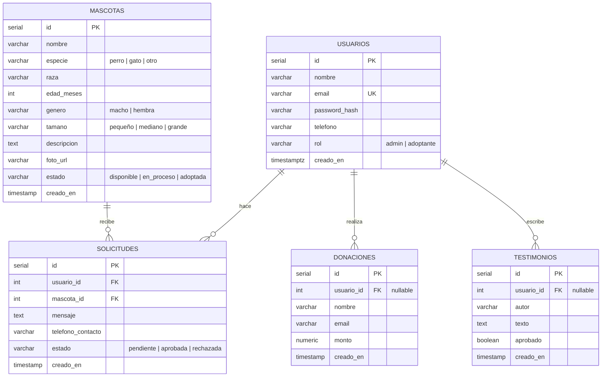

# Modelo de datos (PostgreSQL)

## Reglas de negocio (implementadas en `solicitud.model.js`)
- Una mascota `adoptada` no acepta solicitudes.
- Al crear una solicitud, una mascota `disponible` pasa a `en_proceso`.
- Al rechazar o cancelar, si no quedan solicitudes pendientes, la mascota vuelve a `disponible`.
- Al **aprobar** una solicitud → la mascota pasa a `adoptada` y las demás solicitudes de esa mascota a `rechazada`.
- Un usuario no puede tener dos solicitudes `pendiente` para la misma mascota.
- Solo `admin` crea/edita/borra mascotas y gestiona solicitudes.

## Datos semilla
Las 4 mascotas actuales (Paris, Max, Bella, Luna) con datos corregidos, los 7 testimonios, y un usuario admin de prueba.

Relacionado: [[ADR-002 Base de datos PostgreSQL]], [[API REST]].

## Notas de implementación
- `testimonios.autor` guarda el nombre visible (los testimonios semilla no tienen usuario).
- La regla "una solicitud pendiente por usuario y mascota" se garantiza con un **índice único parcial** (`WHERE estado = 'pendiente'`).
- El seed cifra las contraseñas con `crypt(..., gen_salt('bf'))` de **pgcrypto**: genera hashes bcrypt compatibles con `bcrypt`/`bcryptjs` en Node.
- Los scripts de `database/` se ejecutan **solo** cuando el volumen está vacío. Si cambias el esquema: `npm run db:reset` (borra los datos).
- Las fechas son `TIMESTAMPTZ` (con zona horaria). Con `TIMESTAMP` simple, el navegador mostraba el día siguiente por la diferencia UTC/Colombia (bug encontrado en la Fase 4).
