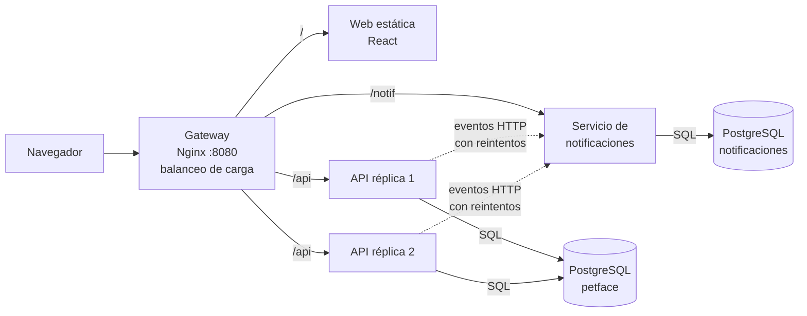
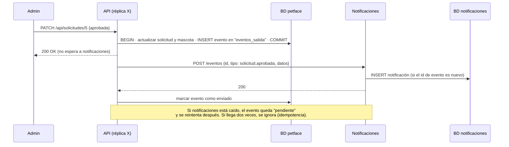
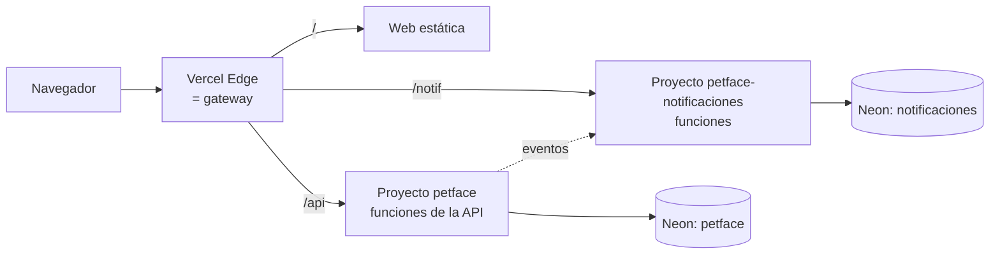

# Plan: sistemas distribuidos

**Requisitos** (definidos el 2026-10-18): varios servicios independientes que se comunican por red, **contenedores con réplicas**, y que funcione **en local y en Vercel**. Prioridad del proyecto: que funcione y se pueda justificar (ver [[Guía de sustentación]]).

## Idea en una frase
Separar las **notificaciones** en un **microservicio** propio (con su propia base de datos), comunicarlo con la API principal mediante **eventos asíncronos con reintentos** (patrón *outbox*), y poner delante un **API Gateway** que reparte la carga entre **varias réplicas** de la API.

## Arquitectura propuesta (local con Docker)

| Pieza | Qué es | Concepto distribuido que demuestra |
|---|---|---|
| **Gateway** (Nginx) | Única puerta de entrada; enruta por URL | API Gateway, proxy inverso, balanceo de carga *round robin* |
| **API ×2 réplicas** | La API MVC actual, en dos contenedores | Escalado horizontal; servicios *stateless* (la sesión va en el JWT, por eso cualquier réplica atiende a cualquier usuario) |
| **Servicio de notificaciones** | Microservicio nuevo, también MVC | Microservicios, **una base de datos por servicio** |
| **Eventos + outbox** | La API guarda el evento en la misma transacción que el cambio y luego lo envía | Comunicación asíncrona, **consistencia eventual**, reintentos, **idempotencia** |
| **Autenticación compartida** | Ambos servicios validan el mismo JWT | Autenticación distribuida sin sesión central |
| **Página "Estado del sistema"** (admin) | Muestra servicios, réplica que atendió, eventos pendientes | Observabilidad: hace *visible* la distribución en la demo |

## ¿Por qué notificaciones?
- Es una necesidad real de la app: avisar al adoptante cuando aprueban o rechazan su solicitud, y al admin cuando llega una solicitud o una donación.
- Es independiente: si el servicio se cae, **la app sigue funcionando** y los avisos llegan cuando vuelve. Es la demo perfecta de tolerancia a fallos.
- Es pequeño: no complica el MVC que ya está hecho.

## Flujo de un evento (ejemplo: el admin aprueba una solicitud)

**Eventos:** `solicitud.creada` (aviso al admin), `solicitud.aprobada` / `solicitud.rechazada` (aviso al adoptante), `donacion.recibida`, `testimonio.publicado`.

**En la web:** una campana 🔔 en la barra con el contador de no leídas y la lista de avisos.

## Producción (Vercel)

- El servicio de notificaciones se despliega como **un segundo proyecto de Vercel** desde el mismo repositorio, con su propia base de datos en Neon.
- El **gateway** son las reglas de `vercel.json`: `/notif/*` se redirige al otro proyecto, así el navegador ve una sola URL.
- Las **réplicas** las crea Vercel solo: escala las funciones según el tráfico. En local se ven explícitas con Docker.
- Los eventos se envían justo después de responder (`waitUntil`) y los pendientes se reintentan en las siguientes peticiones o con un *cron* de Vercel.

## Fases
| Fase | Qué | Resultado visible |
|---|---|---|
| **D1** | Microservicio de notificaciones (MVC, BD propia, pruebas) | Servicio corriendo aparte, con su API |
| **D2** | Eventos desde la API con outbox, reintentos e idempotencia | Al aprobar una solicitud se crea la notificación en el otro servicio |
| **D3** | Campana de notificaciones en la web | El adoptante ve "¡Tu solicitud fue aprobada!" |
| **D4** | Contenedores: Dockerfiles, gateway Nginx, 2 réplicas de la API, página "Estado del sistema" | `npm run distribuido` levanta todo; se ve qué réplica atiende; demo de apagar un servicio |
| **D5** | Despliegue en Vercel: segundo proyecto, segunda BD en Neon, reglas del gateway | Todo funcionando en petface.vercel.app |
| D6 *(opcional)* | Réplica de lectura de PostgreSQL (primaria + réplica) | El catálogo se lee de la réplica |

## Lo que tendrá que hacer el dueño de la cuenta
- Crear una segunda base de datos en Neon y pegar su `DATABASE_URL` en el nuevo proyecto de Vercel.
- Definir una clave interna compartida entre servicios (variable `CLAVE_INTERNA`) y el mismo `JWT_SECRET` en ambos proyectos.

## Decisiones a registrar al implementar
- ADR-007 Microservicio de notificaciones y BD por servicio
- ADR-008 Eventos con outbox en lugar de un broker (RabbitMQ/Kafka): mismo funcionamiento en local y en Vercel, sin infraestructura extra; Vercel no puede mantener consumidores siempre encendidos
- ADR-009 Gateway Nginx y réplicas en Docker
