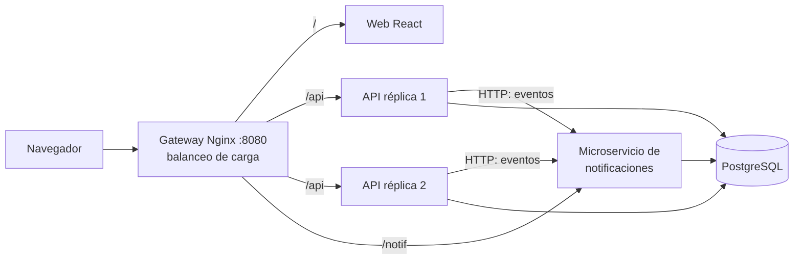

# Plan: sistemas distribuidos (versión simple)

**Requisitos** (2026-10-18): varios servicios que se comunican por red + contenedores con réplicas, en local y en Vercel. **Indicación del equipo: no complicarlo; basta con poder demostrarlo.**

## La idea

| Pieza | Concepto que demuestra |
|---|---|
| **Microservicio de notificaciones** (MVC propio, su propia tabla) | Arquitectura de microservicios: servicios independientes que se comunican por red |
| **La API avisa al microservicio por HTTP** (con tiempo límite) | Comunicación entre servicios; **tolerancia a fallos**: si notificaciones se cae, la app sigue funcionando |
| **Gateway Nginx** | Punto único de entrada, enrutamiento por URL, **balanceo de carga** |
| **2 réplicas de la API** | **Escalado horizontal**; servicios sin estado (la sesión va en el JWT) |
| **Mismo JWT en ambos servicios** | Autenticación distribuida |
| **Tarjeta "Sistema distribuido"** en el admin | Hace visible qué réplica responde y si cada servicio está vivo |

## Avisos que se generan
- Al admin: nueva solicitud de adopción, nueva donación, nuevo testimonio por revisar.
- Al adoptante: solicitud aprobada o rechazada.

## En Vercel
- El microservicio es **otra función** del mismo proyecto (`api/notif.js`): se despliega y escala por separado de la API.
- `vercel.json` hace de gateway: `/notif/*` → función de notificaciones, `/api/*` → función de la API.
- Vercel crea réplicas de cada función según el tráfico.
- La clave entre servicios se deriva de `JWT_SECRET`: **no hay que configurar nada nuevo**.

## Archivos
| Pieza | Dónde |
|---|---|
| Microservicio (MVC) | `notificaciones/src/` → `models/notificacion.model.js`, `controllers/eventos.controller.js`, `controllers/notificaciones.controller.js`, `routes/index.js` |
| Cliente del microservicio en la API | `server/src/services/notificador.js` (tiempo límite de 2 s; nunca rompe la operación) |
| Quién envía eventos | controladores de solicitudes, donaciones y testimonios |
| Campana | `client/src/components/layout/Campana.jsx` (consulta `/notif` cada 20 s) |
| Tarjeta de la demo | `client/src/pages/admin/SistemaDistribuido.jsx` |
| Contenedores | `server/Dockerfile`, `notificaciones/Dockerfile`, `gateway/Dockerfile`, `gateway/nginx.conf`, `docker-compose.yml` (perfil `distribuido`) |
| Vercel | `api/notif.js` + reglas en `vercel.json` |
| Pruebas | `notificaciones/test/` (5) y `server/test/distribuido.test.js` (2: comunicación real entre servicios y tolerancia a fallos) |

## Fases
- [x] D1 · Microservicio de notificaciones + llamadas desde la API
- [x] D2 · Campana 🔔 en la web
- [x] D3 · Docker: gateway + 2 réplicas + microservicio (`npm run distribuido`) + tarjeta en el admin
- [x] D4 · Vercel
